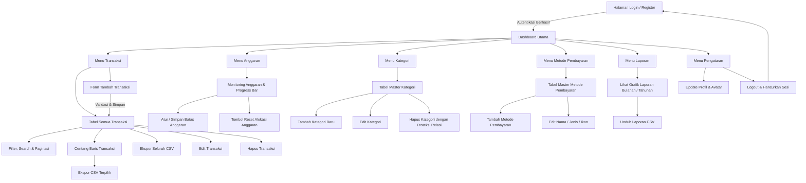
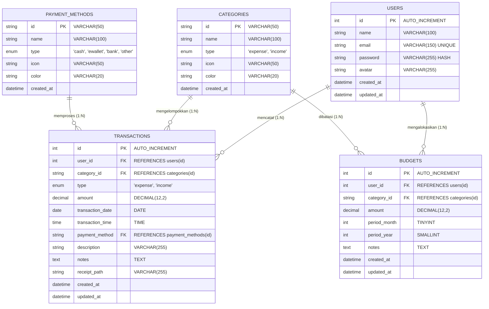
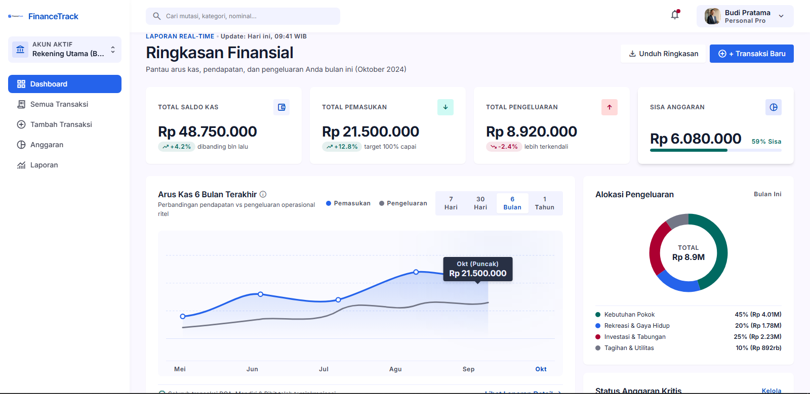
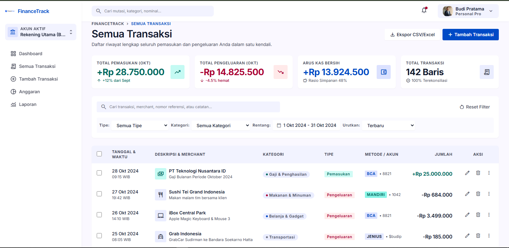
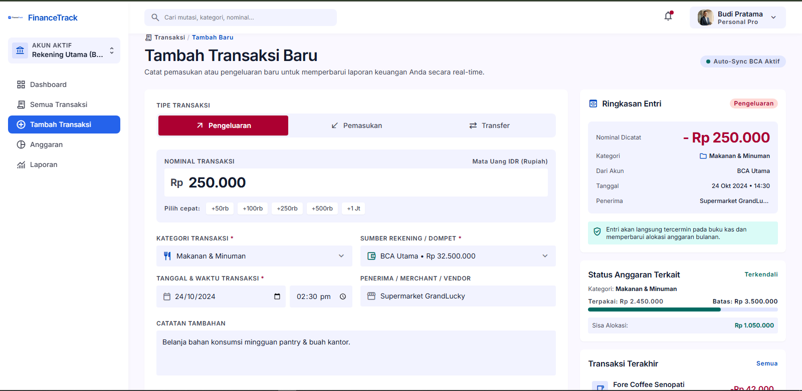
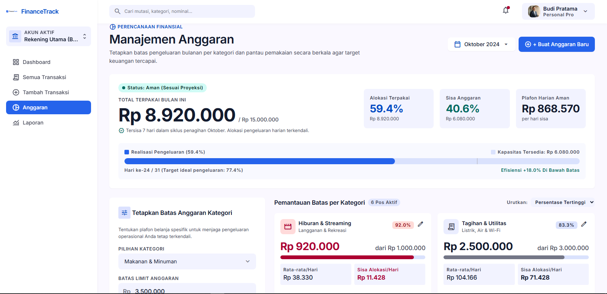
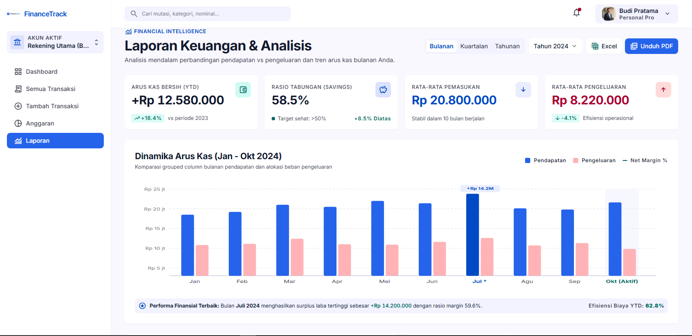

# PERANCANGAN Aplikasi Manajemen Keuangan (FinanceTrack)

**Executive Summary:** Dokumen ini menyajikan perencanaan menyeluruh dan spesifikasi arsitektur final untuk proyek **FinanceTrack** – sebuah aplikasi pencatatan keuangan pribadi dan pengelolaan uang saku berbasis web responsif dengan tema *Light Glassmorphism*. Dokumen ini mencakup identitas proyek, deskripsi, tujuan, target pengguna, ruang lingkup milestone, struktur menu, deskripsi rinci 8 modul halaman, model data relasional (*Entity-Relationship Diagram* / ER-D), alur pengguna (*User Flow*), arsitektur aliran data sistem, use-case skenario, prompt dan tangkapan layar asli Google Stitch, desain high-fidelity Figma, serta pemetaan kriteria penilaian akademik.

---

## 1. Identitas Proyek
- **Nama Proyek:** FinanceTrack (v1.0)
- **Topik Tugas:** No. 6 – Aplikasi Manajemen Keuangan Mahasiswa / Pribadi
- **Nama Pengembang:** Fikri Juana – Presensi ke-16
- **Mata Kuliah:** Pemrograman Web
- **Lingkungan Pengembangan:** Apache 2.4, PHP 8.2 (PDO MySQL), MariaDB / MySQL 10.4, XAMPP, Bootstrap 5, Chart.js, HTML5, Vanilla JavaScript.

---

## 2. Deskripsi Singkat Proyek
FinanceTrack adalah aplikasi web manajemen finansial yang dirancang khusus untuk membantu mahasiswa dan pengguna individu dalam **mencatat pemasukan dan pengeluaran**, **mengontrol batas anggaran belanja**, **mengelola pos kategori dan metode pembayaran**, serta **menganalisis kondisi finansial melalui grafik visual dan laporan periodik**.

Aplikasi mengusung prinsip desain **Light Glassmorphism** (antarmuka transparan elegan dengan latar lembut, backdrop blur, dan kontras tajam) yang diselaraskan secara setia (*visual fidelity*) dari wireframe **Google Stitch** dan **Figma Design System**.

---

## 3. Ruang Lingkup Milestone

- **Milestone 1:** Perencanaan menu, perancangan antarmuka dan wireframing menggunakan Google Stitch dan Figma, penyusunan User Flow, pemodelan data ER-D konseptual, Design System, serta High-Fidelity UI untuk Dashboard dan Data Master.
- **Milestone 2:** Implementasi rancangan UI dari Figma dan Stitch ke dalam markup HTML5 dan styling CSS3 murni (komponen Glassmorphism, grid CSS, flexbox, dan tata letak responsif desktop 1440px hingga mobile 375px).
- **Milestone 3 (Final / Rilis):** 
  - Integrasi backend dinamis menggunakan **PHP Native** dan database **MySQL** via PDO.
  - Implementasi autentikasi pengguna berbasis sesi dan password hashing bcrypt.
  - Aliran data reaktif melalui hidrasi bootstrap (`window.__FT_BOOTSTRAP__`) ke layer JavaScript (`FinanceTrackData`) dan perenderan DOM / Chart.js tanpa ketergantungan reload berat.

---

## 4. Tujuan Proyek
1. **Pencatatan Keuangan Akurat & Cepat:** Memudahkan pencatatan transaksi masuk dan keluar harian dengan opsi kategori, metode pembayaran, tanggal, waktu, catatan, dan bukti transaksi.
2. **Pengendalian Disiplin Anggaran (Budgeting):** Memberikan batasan belanja bulanan per kategori dengan visualisasi progress bar real-time, indikator status peringatan (*Aman*, *Waspada*, *Melebihi*), dan dukungan kategori *Tanpa Batas*.
3. **Analisis Finansial Visual & Laporan:** Menyajikan ringkasan saldo, tren 6 bulan terakhir, komposisi pengeluaran via Doughnut Chart, perbandingan pemasukan vs pengeluaran, serta ekspor CSV yang fleksibel.
4. **Manajemen Master Data Terstruktur:** Memungkinkan penyesuaian pos kategori dan instrumen pembayaran (Kas Tunai, E-Wallet, Rekening Bank) dengan perlindungan integritas relasional database (*foreign key constraints*).

---

## 5. Target Pengguna
- **Mahasiswa:** Mengatur uang saku bulanan, memantau biaya kos, belanja makan harian, bensin, token listrik, internet kuota belajar, buku, fotokopi, dan tabungan.
- **Pekerja Lepas / Freelancer:** Mencatat arus kas pemasukan proyek serta biaya operasional.
- **Pengguna Individu:** Siapa saja yang membutuhkan alat bantu pelacakan uang yang modern, bersih, ringan, dan tidak memerlukan keahlian akuntansi formal.

---

## 6. Struktur Menu & Hierarki Navigasi

Aplikasi menggunakan navigasi vertikal pada sidebar desktop serta *Bottom Navigation Bar* adaptif pada mobile:

```text
FinanceTrack
├── 1. Dashboard (Ringkasan finansial, grafik tren, komposisi, mutasi terkini)
├── 2. Transaksi
│   ├── Semua Transaksi (Tabel riwayat, filter, seleksi checkbox, ekspor CSV)
│   └── Tambah Transaksi (Formulir pencatatan transaksi pemasukan / pengeluaran)
├── 3. Anggaran (Alokasi batas belanja, indikator progress bar, tombol Reset)
├── 4. Kategori (Master data kategori pemasukan & pengeluaran, icon/color picker)
├── 5. Metode Pembayaran (Master data kas, e-wallet, bank, counter mutasi)
├── 6. Laporan (Analisis periodik bulanan/kuartalan/tahunan, grafik komparasi, ekspor)
└── 7. Pengaturan (Profil pengguna, avatar/foto, preferensi akun, logout)
```

---

## 7. Deskripsi 8 Modul Halaman Utama

### 1. Dashboard (`pages/dashboard.php`)
- **Fungsi:** Pusat informasi keuangan pengguna secara komprehensif dalam satu layar.
- **Komponen:**
  - 4 Kartu Ringkasan Glassmorphic: Total Saldo Bersih, Total Pemasukan, Total Pengeluaran, dan Sisa Anggaran Bulanan Aktif.
  - Grafik Tren Keuangan: *Line Chart* interaktif (Chart.js) menampilkan dinamika pemasukan vs pengeluaran selama 6 bulan terakhir.
  - Grafik Komposisi Pengeluaran: *Doughnut Chart* visual yang merinci proporsi belanja berdasarkan kategori.
  - Tombol Aksi Cepat (*Quick Action*): Catat Pemasukan, Catat Pengeluaran, dan Atur Anggaran.
  - Widget Transaksi Terbaru: Menampilkan 5 transaksi mutasi terakhir secara real-time.

### 2. Semua Transaksi (`pages/transaksi.php`)
- **Fungsi:** Mengelola dan menelusuri seluruh riwayat transaksi pemasukan dan pengeluaran.
- **Fitur Unggulan:**
  - **Pencarian Real-Time:** Menemukan transaksi berdasarkan deskripsi, nama kategori, atau metode pembayaran.
  - **Filter Multi-Kriteria:** Filter berdasarkan Jenis (Semua, Pengeluaran, Pemasukan), Kategori, dan Urutan (Terbaru, Terlama, Nominal Tertinggi, Nominal Terendah).
  - **Filter Rentang Tanggal Cepat:** Tombol preset (Hari Ini, 7 Hari Terakhir, 30 Hari Terakhir, Bulan Ini, dan Semua).
  - **Paginasi Client-Side:** Menampilkan data secara rapi per halaman (8 catatan per halaman) dengan navigasi halaman instan.
  - **Checkbox Seleksi & Ekspor Terpilih (*Bulk Selection Export*):** Checkbox pada header tabel (*Select All*) dan setiap baris transaksi. Tombol unduh otomatis bertransformasi menjadi **"Ekspor Terpilih (N)"** saat baris dipilih, mengunduh file CSV khusus transaksi yang dicentang via endpoint `api/reports/export_csv.php?ids=...`.
  - **Aksi Baris:** Tombol Edit (membuka formulir penyuntingan) dan Hapus (modal konfirmasi dengan eksekusi `DELETE` riil di MySQL).

### 3. Tambah & Edit Transaksi (`pages/form-transaksi.php`)
- **Fungsi:** Formulir input terintegrasi untuk mencatat transaksi baru maupun memperbarui transaksi yang sudah ada.
- **Komponen:** Toggle jenis (Pengeluaran / Pemasukan), input nominal rupiah terformat, pemilih tanggal dan waktu, dropdown kategori dinamis dari database, dropdown metode pembayaran, field catatan deskriptif, dan upload bukti struk/kuitansi.

### 4. Anggaran (`pages/anggaran.php`)
- **Fungsi:** Menetapkan dan memonitor batas toleransi pengeluaran bulanan per kategori (*budgeting*).
- **Fitur Unggulan:**
  - **Tampilan Seluruh Kategori:** Menampilkan seluruh kategori pengeluaran, baik yang telah diberi alokasi anggaran maupun yang berstatus *"Tanpa Batas"*.
  - **Visual Progress Bar & Indikator Status:** Menampilkan persentase penggunaan dengan pewarnaan intuitif:
    - *Aman* (penggunaan < 70%, warna hijau / biru).
    - *Waspada* (penggunaan 70% - 99%, warna kuning/oranye).
    - *Melebihi Batas* (penggunaan >= 100%, warna merah).
  - **Tombol Reset Alokasi Anggaran:** Menyediakan tombol `"Reset Alokasi"` bersanding dengan tombol simpan, memungkinkan pengguna melepas batas belanja suatu kategori kembali ke status tanpa batas (nominal 0) tanpa harus menghapus kategori master.

### 5. Master Kategori (`pages/kategori.php`)
- **Fungsi:** Mengelola daftar kategori transaksi sesuai kebutuhan pengguna.
- **Fitur Unggulan:**
  - Pilihan jenis kategori (Pengeluaran vs Pemasukan).
  - Pemilih ikon representatif dari 20 koleksi Google Material Symbols.
  - Color picker palet warna visual untuk identitas visual kategori di chart dan badge.
  - **Antarmuka Bersih:** Nama kategori terpusat sejajar dengan ikon tanpa menampilkan teks ID teknis database di tabel, menciptakan tampilan yang minimalis dan profesional.
  - **Proteksi Integritas Relasi:** Mencegah penghapusan kategori jika kategori tersebut masih terhubung dengan transaksi aktif atau anggaran berjalan, disertai panduan toast informatif.

### 6. Master Metode Pembayaran (`pages/metode-pembayaran.php`)
- **Fungsi:** Mengelola instrumen dan saluran pembayaran yang digunakan pengguna.
- **Fitur Unggulan:**
  - Mendukung klasifikasi jenis metode: Kas Tunai, Dompet Digital (E-Wallet), Rekening Bank, dan Lainnya.
  - Counter mutasi otomatis yang menghitung jumlah transaksi terkait untuk setiap metode pembayaran.
  - Filter pills cepat untuk menyaring daftar metode berdasarkan jenisnya.
  - Field ID Sistem yang transparan dan aman untuk menjamin konsistensi foreign key transaksi.

### 7. Laporan Keuangan (`pages/laporan.php`)
- **Fungsi:** Evaluasi performa finansial periodik.
- **Komponen:**
  - Pilihan rentang laporan: Bulanan, Kuartalan, dan Tahunan.
  - Grafik batang komparatif pemasukan vs pengeluaran per bulan.
  - Ringkasan arus kas bersih dan rasio tabungan.
  - Rincian belanja per pos kategori.
  - Tombol Ekspor CSV Laporan Lengkap.

### 8. Pengaturan Akun & Profil (`pages/pengaturan.php`)
- **Fungsi:** Personalisasi identitas pengguna dan pengelolaan akun.
- **Komponen:** Ubah nama tampilan pengguna, unggah foto avatar atau gunakan fallback inisial otomatis, info profil dan email, daftar ringkas master keuangan, dan tombol logout dengan pembersihan sesi server.

---

## 8. Alur Pengguna (User Flow)

Diagram alir pengguna berikut menggambarkan alur navigasi dari autentikasi hingga pengelolaan transaksi, anggaran, dan master data:



---

## 9. Model Data Relasional (ER-D Final)

Model data relasional yang diimplementasikan pada database MariaDB/MySQL (`financetrack_db`) terdiri atas 5 tabel yang dinormalisasi dengan integritas referensial penuh:



### Aturan Integritas Relasional:
- `transactions.user_id` dan `budgets.user_id` memiliki foreign key constraint `ON DELETE CASCADE` ke `users.id`.
- `transactions.category_id` dan `budgets.category_id` memiliki foreign key constraint `ON DELETE RESTRICT` ke `categories.id`, menjamin data transaksi dan histori anggaran tidak menjadi yatim (*orphan records*) jika suatu kategori hendak dihapus.
- `transactions.payment_method` mereferensikan `payment_methods.id` dengan relasi `ON UPDATE CASCADE ON DELETE RESTRICT`.

---

## 10. Arsitektur Aliran Data Sistem

Aplikasi menerapkan pola arsitektur data reaktif tanpa framework berat (*clean separation of concerns*):

```text
┌─────────────────┐
│ Database MySQL  │ (Tabel: users, categories, payment_methods, transactions, budgets)
└────────┬────────┘
         │ PDO Query Prepared Statements
         ▼
┌─────────────────┐
│ PHP Application │ (auth/middleware.php & database/bootstrap.php)
└────────┬────────┘
         │ Server-Side Hydration
         ▼
┌─────────────────────────┐
│ window.__FT_BOOTSTRAP__ │ (Objek Global Data State di Browser)
└────────┬────────────────┘
         │ Inisialisasi State
         ▼
┌─────────────────────────┐
│ FinanceTrackData        │ (assets/js/data.js: Model State, Getters, Setters, Helpers)
└────────┬────────────────┘
         │ Binding Event & Rendering Reaktif
         ▼
┌─────────────────────────┐
│ DOM / UI & Chart.js     │ (Tabel, Kartu Glassmorphic, Badge, Line & Doughnut Charts)
└─────────────────────────┘
```

Jika terjadi mutasi data (misal pengguna menambah transaksi, mengedit metode pembayaran, atau mereset anggaran):
1. JavaScript mengirimkan request `fetch()` asinkron ke endpoint API (`api/...`).
2. Backend PHP memvalidasi session dan mengeksekusi prepared statement ke MySQL.
3. API merespons dengan JSON `{ success: true, data: ... }`.
4. JavaScript memutakhirkan memori lokal `FinanceTrackData` dan `window.__FT_BOOTSTRAP__`, kemudian secara instan memanggil fungsi render tabel dan kalkulasi kartu ringkasan tanpa reload halaman.

---

## 11. Sinkronisasi Penuh dengan Google Stitch & Figma

FinanceTrack dikembangkan dengan menjaga keselarasan penuh terhadap desain awal pada **Google Stitch** dan **Figma**.

### Tautan Desain Resmi:
- **Google Stitch Project:** [https://stitch.withgoogle.com/projects/3478365220676083171](https://stitch.withgoogle.com/projects/3478365220676083171)
- **Figma UI Design & Design System:** [https://www.figma.com/design/m9ngc2WcRYET36eKg1yR8w/FinanceTrack-%E2%80%94-UI-Design?node-id=0-1&t=gT2c4fb5wPVHOZU6-1](https://www.figma.com/design/m9ngc2WcRYET36eKg1yR8w/FinanceTrack-%E2%80%94-UI-Design?node-id=0-1&t=gT2c4fb5wPVHOZU6-1)

---

### Prompt Asli Google Stitch (Wireframe)

```text
- Dashboard: "Buatlah wireframe halaman Dashboard Aplikasi FinanceTrack dengan desain modern. Gunakan palet warna netral/keuangan (biru/teal/abu), tipografi yang mudah dibaca, dan layout bersih. Tampilan harus menampilkan ringkasan saldo, grafik tren keuangan, serta komponen utama seperti kartu ringkasan (total pemasukan, pengeluaran). Ikon dan chart sederhana untuk memperjelas data."

- Semua Transaksi: "Buatlah wireframe halaman Semua Transaksi. Desain modern dengan tabel daftar transaksi (kolom tanggal, tipe, kategori, jumlah). Sertakan kolom aksi (edit/hapus) dan fitur pencarian/penyaringan. Gunakan palet warna yang seragam dan tipografi jelas."

- Tambah Transaksi: "Buatlah wireframe halaman Tambah Transaksi. Tampilkan form input dengan field jenis transaksi (pendapatan/pengeluaran), kategori (dropdown), tanggal, dan jumlah. Desain modern dengan tombol simpan yang menonjol. Palet warna netral (biru/teal/abu) dan tipografi mudah dibaca."

- Anggaran: "Buatlah wireframe halaman Anggaran. Halaman berisi form untuk menetapkan batas anggaran per kategori (input kategori, limit). Sertakan visualisasi ringkas (misalnya progress bar) yang menunjukkan persentase penggunaan anggaran. Gaya UI modern dengan warna netral dan tata letak jelas."

- Laporan: "Buatlah wireframe halaman Laporan. Halaman menampilkan grafik bulanan (bar chart atau line chart) pendapatan vs pengeluaran. Desain minimalis namun informatif, dengan keterangan jelas. Warna netral dan tipografi konsisten."
```

---

### Hasil Wireframe Google Stitch Asli

#### 1. Dashboard


#### 2. Semua Transaksi


#### 3. Tambah Transaksi


#### 4. Anggaran


#### 5. Laporan


---

### Implementasi Kesetiaan Visual (Visual Fidelity)
Desain wireframe Stitch diterjemahkan ke dalam kode aplikasi dengan mematuhi prinsip-prinsip:
1. **Glassmorphism Token**: Menggunakan token CSS `:root` (`--surface: rgba(255, 255, 255, 0.72)`, `--surface-glass: rgba(255, 255, 255, 0.85)`, `backdrop-filter: blur(16px)`).
2. **Kesesuaian Hierarki Komponen**: Setiap tata letak kartu ringkasan, filter bar, search input, tabel transaksi dengan checkbox, badge kategori, dan navigasi bawah mobile mengikuti tata letak wireframe Stitch asli.
3. **Penyempurnaan Tanpa Mengubah Struktur**:
   - Checkbox di tabel transaksi Stitch yang awalnya hanya elemen statis, kini diperdayakan menjadi pemicu aksi unduh **Ekspor CSV Terpilih**.
   - Halaman anggaran Stitch yang awalnya hanya menampilkan kategori beranggaran, kini disempurnakan menampilkan seluruh kategori lengkap dengan tombol **Reset Alokasi**.
   - Halaman Kategori dan Metode Pembayaran dibangun menggunakan *design language* yang identik sehingga harmonis dengan 5 layar utama Stitch.

---

## 12. Skenario Use-Case Utama

1. **Mencatat Transaksi Harian:** Mahasiswa mencatat pengeluaran makan siang Rp 22.000 dengan memilih jenis Pengeluaran, kategori Makanan, metode Cash, dan tanggal hari ini. Saldo dan grafik pengeluaran di Dashboard langsung berkurang seketika.
2. **Memonitor & Mereset Anggaran Belanja:** Pengguna memeriksa pos pengeluaran Makanan yang telah terpakai 65%. Jika pengguna memutuskan untuk tidak lagi membatasi pos pengeluaran tertentu, pengguna cukup mengklik kartu kategori tersebut lalu menekan tombol `"Reset Alokasi"` untuk mengembalikannya ke status *Tanpa Batas*.
3. **Menyeleksi & Mengekspor Transaksi Tertentu:** Pengguna ingin melaporkan pengeluaran praktikum kuliah kepada dosen/orang tua. Pengguna mencentang 3 baris transaksi fotokopi dan buku di tabel, tombol berubah menjadi `"Ekspor Terpilih (3)"`, dan ketika diklik langsung mengunduh file CSV yang hanya memuat 3 transaksi tersebut.
4. **Menambah & Mengubah Pos Kategori / Metode Pembayaran:** Pengguna dapat menambahkan kategori baru seperti *"Tabungan Umroh"* atau metode pembayaran *"ShopeePay"* lengkap dengan pemilihan ikon Material Symbols dan warna visual. Jika kategori sedang digunakan dalam transaksi aktif, sistem menolak penghapusan secara aman untuk menjaga validitas data.
5. **Evaluasi Keuangan Periodik:** Pengguna membuka menu Laporan untuk menganalisis tren pemasukan dan pengeluaran selama satu semester serta mengunduh rekap CSV keseluruhan.

---

## 13. Pemetaan Kriteria Penilaian Akademik

| Kriteria Penilaian | Implementasi Nyata pada FinanceTrack | Status |
|---|---|---|
| **Struktur Menu & Navigasi** | Sidebar vertikal 8 modul + Bottom Navigation mobile yang responsif. | Terpenuhi (100%) |
| **Perancangan Wireframe & UI** | 5 Layar utama dirancang di Google Stitch dan dikembangkan di Figma. | Terpenuhi (100%) |
| **Model Data ER-D** | 5 Tabel ternormalisasi MySQL lengkap dengan Foreign Key & relasi 1:N. | Terpenuhi (100%) |
| **Implementasi Frontend** | HTML5 semantik, CSS3 Light Glassmorphism, Bootstrap 5, Chart.js. | Terpenuhi (100%) |
| **Implementasi Backend & Database** | PHP 8 PDO Prepared Statements, Session Auth, API Endpoints, MySQL CRUD. | Terpenuhi (100%) |
| **Responsivitas Antarmuka** | Teruji dan optimal pada breakpoint desktop (1440px) hingga mobile (375px). | Terpenuhi (100%) |
| **Dokumentasi & Keselarasan** | Dokumen `PERANCANGAN.md` selaras 100% dengan kode dan wireframe Stitch. | Terpenuhi (100%) |

---

*Dokumen Perancangan ini disusun sebagai bagian dari pemenuhan tugas proyek mata kuliah Pemrograman Web.*
